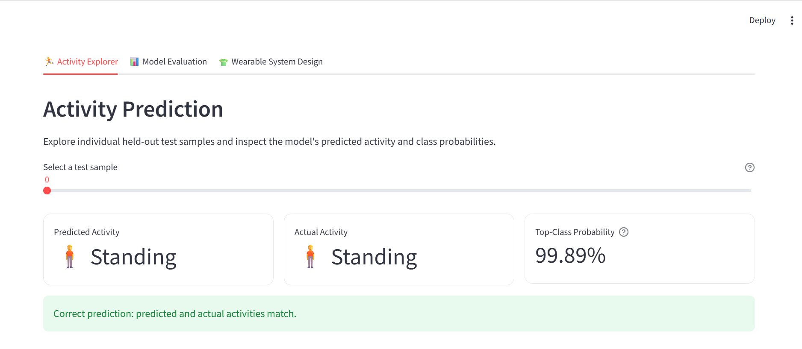

\# WearSense: AI-Powered Activity and Posture Monitoring


WearSense is a software-based human activity recognition and posture-monitoring prototype that uses machine learning to classify movement and static postures from wearable-sensor data. It combines a trained activity-classification model with an interactive Streamlit dashboard for exploring predictions, model performance, and classification errors.


The project explores how machine learning can support intelligent wearable technology, with potential applications in activity tracking, movement analysis, and posture awareness.


## Dashboard Preview



The interactive dashboard supports activity exploration, model evaluation, prediction inspection, and classification-error analysis.


\## Project Objectives


\- Classify six everyday activities using sensor-derived features.

\- Compare multiple machine learning models.

\- Evaluate model performance using participant-grouped cross-validation.

\- Inspect activity-level performance and common classification errors.

\- Present predictions and evaluation results through an interactive dashboard.


\## Activities Recognized


1\. Walking

2\. Walking upstairs

3\. Walking downstairs

4\. Sitting

5\. Standing

6\. Laying


\## Dataset


WearSense uses the \*\*UCI Human Activity Recognition Using Smartphones Dataset\*\*, which contains sensor recordings collected from participants performing everyday activities.


The dataset provides preprocessed feature vectors derived from smartphone accelerometer and gyroscope signals. The project uses the supplied training and test partitions and participant identifiers to support model development and participant-grouped validation.


Dataset source: \[UCI Machine Learning Repository — Human Activity Recognition Using Smartphones](https://archive.ics.uci.edu/dataset/240/human+activity+recognition+using+smartphones)


\## Machine Learning Models


The project explores the following models:


\- Logistic Regression

\- Random Forest

\- RBF Support Vector Machine (SVM)

\- Extra Trees Classifier


The current preferred model candidate is an RBF SVM with `C=10` and `gamma=0.001`, selected based on participant-grouped cross-validation comparisons.


\## Evaluation Results


The SVM achieved the following results during five-fold participant-grouped cross-validation:


| Metric | Score |

|---|---:|

| Accuracy | 93.00% |

| Balanced accuracy | 92.96% |

| Macro-F1 | 92.86% |


In the development-stage evaluation on the supplied test partition, the saved grouped-CV-selected SVM achieved:


| Metric | Score |

|---|---:|

| Accuracy | 95.32% |

| Balanced accuracy | 95.16% |

| Macro-F1 | 95.25% |


\*\*Evaluation note:\*\* The supplied test partition has been inspected during development. Its results are therefore exploratory and should not be presented as an untouched, independent final evaluation.


\## Application Features


\- Activity Explorer for inspecting predictions and class probabilities.

\- Model Evaluation view with performance metrics and a confusion matrix.

\- Prediction inspection with actual and predicted activity labels.

\- Filters for reviewing correct predictions and misclassifications.

\- Activity-level and model-comparison reports.

\- Feature-importance analysis and saved evaluation figures.


\## Technology Stack


\- Python

\- pandas and NumPy

\- scikit-learn

\- joblib

\- Streamlit

\- Matplotlib


\## Project Structure


```text

WearSense/

├── app.py

├── data/

│   └── UCI HAR Dataset/

├── models/

│   ├── logistic\_regression.joblib

│   ├── random\_forest.joblib

│   ├── rbf\_svm.joblib

│   └── rbf\_svm\_grouped\_best.joblib

├── report/

│   ├── best\_svm/

│   ├── figures/

│   ├── svm\_vs\_extra\_trees.csv

│   └── evaluation\_metrics.csv

└── src/

&#x20;   ├── compare\_extra\_trees.py

&#x20;   ├── evaluate\_best\_svm.py

&#x20;   ├── final\_evaluation.py

&#x20;   ├── grouped\_validation.py

&#x20;   ├── grouped\_tune\_models.py

&#x20;   ├── feature\_analysis.py

&#x20;   └── train\_best\_svm.py

```


\## Installation and Setup


The project was developed using Python 3.10 in a Conda environment.


Create and activate the environment:


```bash

conda create -n wearsense python=3.10

conda activate wearsense

```


Install the required packages:


```bash

pip install numpy pandas scikit-learn joblib streamlit matplotlib

```


Run the application from the project root:


```bash

streamlit run app.py

```


The application should open in your browser.


\## Limitations


\- The current system uses a public smartphone-sensor dataset rather than data collected from a custom smart garment.

\- The model classifies predefined activities; it does not directly measure joint angles, diagnose posture disorders, or provide medical advice.

\- The dashboard demonstrates a software workflow. It does not currently integrate with a physical wearable device or a live sensor stream.

\- Performance on new users and different sensor placements requires further validation.


\## Future Work


Potential extensions include real-time sensor-stream processing, temporal activity modelling, personalized calibration, deployment on mobile or wearable platforms, and evaluation with data collected from actual wearable devices.


\## Project Status


\*\*Software prototype:\*\* Core model development, grouped validation, evaluation reports, and the interactive dashboard are implemented. Documentation and final repository preparation are in progress.


