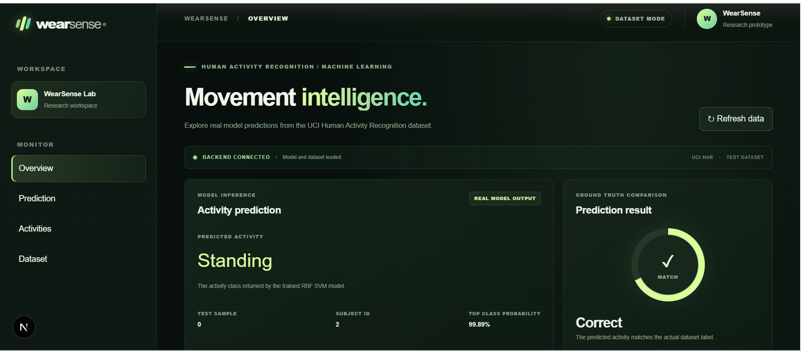

# WearSense — Intelligence in Every Movement

An AI-powered Human Activity Recognition (HAR) system that uses smartphone sensor data and machine learning to identify and classify human physical activities.

WearSense combines a machine learning prediction pipeline with an interactive web dashboard to explore activity predictions, compare actual and predicted labels, and inspect model output.

## Dashboard Preview



*WearSense 2.0 — Interactive activity recognition dashboard.*

## Project Overview

WearSense is built around the UCI Human Activity Recognition Using Smartphones dataset. It uses accelerometer and gyroscope-derived features to classify six human activities.

The system allows users to explore dataset samples and view the activity predicted by the trained machine learning model alongside the corresponding actual activity.

## Key Features

- Human Activity Recognition using machine learning.
- Six-class activity classification.
- Prediction using a trained RBF Support Vector Machine model.
- Actual-versus-predicted activity comparison.
- Class probability visualization.
- Dataset sample selection and navigation.
- Interactive dashboard with an immersive interface.
- FastAPI backend integration with a Next.js frontend.
- Backend health monitoring.

## Supported Activities

| Activity ID | Activity |
|---|---|
| 1 | Walking |
| 2 | Walking Upstairs |
| 3 | Walking Downstairs |
| 4 | Sitting |
| 5 | Standing |
| 6 | Laying |

## Technology Stack

**Machine Learning and Backend**
- Python
- Scikit-learn
- NumPy
- Pandas
- Joblib
- FastAPI
- Uvicorn

**Frontend**
- Next.js
- React
- TypeScript
- CSS Modules

## Dataset

**UCI Human Activity Recognition Using Smartphones**

The dataset contains smartphone accelerometer and gyroscope recordings collected from participants performing different physical activities.

- Six activity classes.
- 561 engineered features per sample.
- Original training and test partitions.
- Subject identifiers associated with the recordings.

Dataset source: [UCI Machine Learning Repository](https://archive.ics.uci.edu/dataset/240/human+activity+recognition+using+smartphones)

## Machine Learning Model

WearSense uses a trained RBF Support Vector Machine (SVM) model for activity classification.

The model receives the engineered feature vector from a dataset sample and returns:
- Predicted activity.
- Predicted activity class.
- Class probability outputs.
- Comparison with the actual dataset label.

The probability outputs should not be interpreted as calibrated certainty estimates.

## System Architecture

```text
UCI HAR Dataset
       |
       v
Dataset Processing
       |
       v
561 Engineered Features
       |
       v
Trained RBF SVM Model
       |
       v
FastAPI Backend
       |
       v
Next.js Frontend
       |
       v
Interactive WearSense Dashboard
```

## Project Structure

```text
WearSense/
|
|-- backend/
|   |-- main.py
|   |-- config.py
|   |-- schemas/
|   |-- services/
|
|-- frontend/
|   |-- public/
|   |-- src/
|       |-- app/
|           |-- dashboard/
|               |-- page.tsx
|               |-- dashboard.module.css
|
|-- docs/
|   |-- dashboard-preview.png
|
|-- inspect_models.py
|-- app_backup_before_dataset_fix.py
|-- README.md
```

## Getting Started

### 1. Clone the repository

```bash
git clone https://github.com/AnanyaSRV/Wear-Sense.git
cd Wear-Sense
```

### 2. Set up the Python environment

Activate your existing Conda environment or create an environment with the required backend dependencies.

```bash
conda activate wearsense
```

Install the backend dependencies from your project's dependency file, if provided.

### 3. Start the backend

From the project root:

```bash
python -m uvicorn backend.main:app --reload
```

The backend runs at:

`http://127.0.0.1:8000`

API documentation:

`http://127.0.0.1:8000/docs`

### 4. Configure the frontend

Create `frontend/.env.local`:

```env
NEXT_PUBLIC_WEARSENSE_API_URL=http://127.0.0.1:8000
```

### 5. Install frontend dependencies

```bash
cd frontend
npm install
```

### 6. Start the frontend

```bash
npm run dev
```

Open:

`http://localhost:3000/dashboard`

## Important Project Scope

WearSense currently performs dataset-based human activity recognition.

It uses recorded smartphone sensor data from the UCI HAR dataset. It does not currently provide live wearable sensor streaming, real-time heart-rate monitoring, step counting, or calorie measurement.

The model's evaluation results should be interpreted in the context of the dataset and development process.

## Future Enhancements

- Integration with physical wearable sensors.
- Real-time activity recognition.
- Expanded activity datasets.
- Personalized activity analysis.
- Additional model evaluation and validation.

## Author

**Ananya SRV**

GitHub: [AnanyaSRV](https://github.com/AnanyaSRV)

Repository: [Wear-Sense](https://github.com/AnanyaSRV/Wear-Sense)

---

*WearSense — Intelligence in Every Movement.*